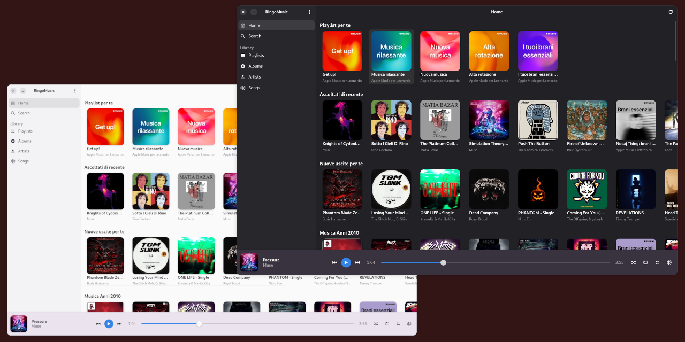

<p align="center">
  
</p>

# RingoMusic

RingoMusic is an open-source client for Apple Music on Linux. It looks and feels like a native GNOME application. The user interface and all application logic are Rust code (GTK 4 and libadwaita). A hidden Chromium engine plays the DRM-protected audio.

Website: <https://ringomusic.netlify.app/>

RingoMusic is not affiliated with, endorsed by, or sponsored by Apple. You need an Apple Music subscription to use it.

**Status: Under development. Not ready for use.**

<p align="center">
  
</p>

## Supported platforms

RingoMusic supports x86_64 Linux only. The minimum distributions are:

- Debian 13
- Ubuntu 26.04 LTS
- The two supported Fedora releases

These distributions have GTK 4.18, libadwaita 1.7, and glibc 2.41 or newer. Older distributions, such as Ubuntu 24.04, are not supported.

## Architecture

```
┌──────────────────────── ringomusic (Rust) ────────────────────────┐
│  ui        gtk4 + libadwaita, relm4                               │
│     │ messages                                                    │
│  core      state store, queue model, cache (SQLite)               │
│     ├── am-api   typed Apple Music models over ApiTransport       │
│     ├── mpris    D-Bus MPRIS server                               │
│     └── engine   PlaybackEngine trait, sidecar supervisor         │
└───────────────────────────────┬───────────────────────────────────┘
                                │ JSON-RPC 2.0, NDJSON, Unix socket
┌───────────────────────────────▼───────────────────────────────────┐
│  ringomusic-engine (CastLabs Electron, hidden window)             │
│  music.apple.com → MusicKit.getInstance() → hook script           │
│  Widevine CDM → Chromium audio → PipeWire                         │
└───────────────────────────────────────────────────────────────────┘
```

Rust owns all state. The engine plays audio and sends Apple Music API requests. The engine keeps the login session. RingoMusic never reads or stores your credentials.

## Non-goals

- RingoMusic is not published on Flathub or in distribution repositories.
- RingoMusic does not download, export, or record audio. This rule is permanent.
- RingoMusic does not supply an equalizer or other audio processing in version 1.0.
- RingoMusic does not support aarch64. No official Widevine CDM exists for aarch64 Linux.
- RingoMusic does not supply lossless or Dolby Atmos audio. The web path gives AAC at 256 kbps only.

## Build from source

Requirements:

- Rust (stable toolchain)
- Node.js 24 or newer
- GTK 4.18 development files
- libadwaita 1.7 development files

Build the Rust workspace:

```sh
cargo build
```

Build the engine:

```sh
cd engine && npm ci && npm run build
```

Run the developer CLI against the engine. Build the engine first, then set the engine command:

```sh
export RINGO_ENGINE_CMD="$PWD/engine/node_modules/.bin/electron"
export RINGO_ENGINE_ARGS="$PWD/engine/"
cargo run -p ringo-cli -- signin
cargo run -p ringo-cli -- search radiohead
```

Run `ringo-cli --help` for all commands.

The GUI reads its settings from GSettings. Cargo compiles the schema into `target/`. Point
GSettings at it when you run the GUI from the source tree (`<profile>` is `debug` or `release`):

```sh
export GSETTINGS_SCHEMA_DIR="$(echo "$PWD"/target/<profile>/build/ringo-core-*/out/schemas)"
```

The build needs `glib-compile-schemas` (package `libglib2.0-bin` on Debian).

## Keyboard Shortcuts

| Shortcut | Action |
|---|---|
| `Ctrl`+`Space` | Play or pause |
| `Ctrl`+`Right` | Next song |
| `Ctrl`+`Left` | Previous song |
| `Ctrl`+`S` | Toggle shuffle |
| `Ctrl`+`R` | Cycle repeat mode |
| `Ctrl`+`F` | Search |
| `F9` | Show or hide the queue |
| `F5` | Refresh the home page |
| `Ctrl`+`,` | Preferences |
| `Ctrl`+`Q` | Quit |
| `Esc` | Close a dialog or the queue panel, or go back |

## Contributing

Read [CONTRIBUTING.md](CONTRIBUTING.md) before you open a pull request.

## License

RingoMusic is free software. It uses the GNU General Public License, version 3 or later (`GPL-3.0-or-later`). See the [LICENSE](LICENSE) file.
